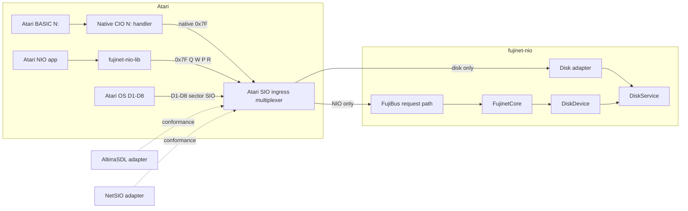

# Architecture Spine — Atari NIO physical SIO

## Design Paradigm

**Ports and adapters.** `FujinetCore`, `DiskDevice`, and `DiskService` are the service ports. Atari SIO adapters translate either application-channel or Atari OS disk envelopes at the edge; client, firmware, AltirraSDL, and NetSIO own their distinct edges.



## Invariants & Rules

### AD-1 — Two ingress planes, one SIO boundary [ADOPTED]

- **Binds:** CAP-1, CAP-3, CAP-4
- **Prevents:** A `0x7F` packet parser consuming Atari disk traffic, or a disk adapter accepting application-service traffic.
- **Rule:** `fujinet-nio` has one Atari SIO ingress multiplexer. It routes only `0x7F` to NIO `Q`/`W`/`P`/`R`, only `D1:`–`D8:` to the standard disk frontend, and silently ignores every other device ID.

### AD-2 — Service ownership remains in the core [ADOPTED]

- **Binds:** CAP-1, CAP-2, CAP-3
- **Prevents:** Firmware, emulator, or disk code reimplementing image parsing, URI resolution, FujiBus service codecs, or service state.
- **Rule:** The NIO plane creates/consumes packet-native FujiBus through `DiskDevice` where it accesses disk services. The disk plane composes `DiskService` directly for standard Atari sector/status exchanges. Neither adapter may call a legacy transport or expose FujiBus framing to the Atari OS.

### AD-3 — Packet-native NIO channel is exact and bounded [ADOPTED]

- **Binds:** CAP-1, CAP-2, CAP-3, CAP-4
- **Prevents:** Per-backend SLIP revival, padded reads, ambiguous readiness, or divergent capacity/recovery behavior.
- **Rule:** All `0x7F` adapters implement the resolved `Q`/`W`/`P`/`R` contract: one packet-native request/response, client/fixture AUX/DCB agreement where variable, and one outstanding request. `Q` is optional for clients; it uses AUX `0` and DCB receive length `4` at `P=idle`, while the device validates observable AUX/state and returns `{wire revision=1, little-endian maximum payload >=512, feature flags}` without creating or consuming that transaction; bit 0 is advisory PROC support. `W` is legal only at idle; a pending or ready transaction rejects it with `NAK`. `P` uses AUX `0` and DCB receive length `3`, returning `{0=idle, 1=pending, 2=ready, little-endian length}` with zero length except in ready state. A bad observable `R` AUX length retains the response; a valid `R` consumes it and returns the next `P` to idle even if client-side transfer is interrupted. The shared initially 512-byte payload limit is mandatory for v1; a querying client uses the lesser of its compiled limit and `Q` maximum, while a lower-capacity profile requires a newer wire revision and matching fixtures. A local client timeout does not cancel accepted work. The library does not retry automatically; applications retry only operations whose semantics make that safe.

### AD-4 — Atari library is an application-channel client [ADOPTED]

- **Binds:** CAP-2, CAP-5
- **Prevents:** cc65 applications embedding disk emulation, owning NIO service codecs, or hijacking Atari interrupt vectors.
- **Rule:** `repos/fujinet-nio-lib` owns public-API use, `0x7F` exchange, bounded buffers, configurable deadline/retry policy, polling, and an ISR-safe PROC flag hook. It exposes capability discovery as an explicit opt-in; ordinary applications start at the 512-byte baseline and do not issue `Q`. It does not implement `D:` behavior, install/replace `VPRCED`, or make a PROC pulse a correctness dependency.

### AD-5 — Firmware owns physical sequencing and boot projection [ADOPTED]

- **Binds:** CAP-1, CAP-3, CAP-5
- **Prevents:** POSIX/emulator details leaking into the board profile or boot/media ownership being split across adapters.
- **Rule:** `repos/fujinet-nio` owns the v1 GPIO/UART command sequence, released-idle open-drain DATA OUT/PROC behavior, packet server state, disk envelope translation, and applying `boot.mode`/`boot.config_uri` plus restored slots to DiskService. Config mode presents the flashed configuration ATR as `D1:`; normal mode presents restored URI-backed slots.

### AD-6 — PROC is an advisory, application-owned edge [ADOPTED]

- **Binds:** CAP-2, CAP-3, CAP-5
- **Prevents:** a shared-bus pulse being mistaken for a FujiNet-specific reason or library code clobbering an application's IRQ chain.
- **Rule:** Firmware emits a bounded, rate-limited PROC pulse only on NIO response-ready transition. The application may chain its own handler and call the library flag hook; normal-context code must confirm `P=ready` before `R`. Polling-only operation is fully conformant.

### AD-7 — Literal vectors are the conformance authority [ASSUMPTION]

- **Binds:** CAP-1, CAP-4
- **Prevents:** separately hand-maintained byte constants and a shared implementation defect passing every virtual test.
- **Rule:** Workspace-owned `integration-tests/atari-sio` fixtures and scenario manifests are the canonical literal representation of NIO `W`/`P`/`R`, disk sector/status, malformed-input, recovery, and boot scenarios. Repository tests consume generated or checked projections and must not use the production serializer/framer as their oracle.

### AD-8 — Virtual regressions and physical evidence are non-substitutable [ADOPTED]

- **Binds:** CAP-3, CAP-4, CAP-5
- **Prevents:** an AltirraSDL or NetSIO pass being reported as GPIO/electrical validation, or board observations obscuring protocol regressions.
- **Rule:** AltirraSDL and NetSIO independently implement the conformance adapter and run the same fixtures, boot, and guest-XEX scenarios. Real-hardware acceptance runs only after virtual conformance and records board, Atari, cable, firmware/client revisions, electrical/timing, recovery, and PROC/polling observations.

### AD-9 — Native-contract migration has no compatibility aliases [ADOPTED]

- **Binds:** CAP-1, CAP-2, CAP-4
- **Prevents:** a passing virtual regression silently exercising SLIP, padded reads, or an old `0x71` device alias instead of the adopted `0x7F` protocol.
- **Rule:** The Atari backend, ESP32 channel, NetSIO adapter, AltirraSDL adapter, profile selection, and their conformance tests replace SLIP framing, padded `R`, and `0x71` aliases with the exact v1 `0x7F` contract. Legacy-only tests may remain as historical coverage but are excluded from Atari NIO v1 conformance and acceptance.

### AD-10 — BASIC N: is a native client adapter [ADOPTED]

- **Binds:** CAP-2, CAP-5, CAP-6
- **Prevents:** the user-facing `N1:` syntax pulling `0x71`–`0x78`, legacy `O/C/R/W/S` framing, or `LegacyTransport` back into native Atari NIO.
- **Rule:** The user's DOS startup installs the relocatable, CA65-only resident CIO `N:` module, initializes its state, reserves memory below `MEMLO` and safely registers `HATABS`. MyDOS 4.53/4 is the first verified environment; the configuration ATR remains the existing transient configuration/boot-selection environment. Same-handler installation is idempotent, a foreign handler is preserved and failure rolls back. Permanent RAM, including zero page and retained workspace, is at most 3,072 bytes. CIO IOCBs own native NetworkService handles over `$7F`; read/write/update select GET/PUT/POST, output sets `BODY_UNKNOWN`, and bounded 128-byte caches preserve ordered bytes and short acknowledgements. Output commits exactly once before first STATUS/read/CLOSE, without replaying uncertain writes or commits. NetSIO reset events reclaim owned sessions without flushing or committing incomplete output. Genuine OS warm-start persistence and physical SIO reset detection are unverified and deferred to platform/physical acceptance outside Story 2.5. The handler does not use legacy SIO network IDs or compatibility adapters. Atari DOS 2.0S/2.5, SpartaDOS and SpartaDOS X are follow-on targets for the same module with DOS-appropriate installation. MyDOS BASIC READ/PUT/POST is verified through the embedded AltirraSDL adapter; `config://` access to original configuration/boot disk files after DOS selection is a deferred idea, not a current feature.

## Consistency Conventions

| Concern | Convention |
| --- | --- |
| SIO naming | `nio` names only the `0x7F` application plane; `disk` names only standard Atari `D1:`–`D8:` handling. |
| Service routing | `WireDeviceId` exists inside FujiBus only; no SIO device address is a FujiBus service selector. |
| Shared state | The multiplexer owns one active NIO transaction; DiskService owns slots, media, and boot/runtime mount state. |
| Errors and observability | NIO transport rejection uses `NAK`; application/service outcomes remain FujiBus responses; every adapter records the same scenario/vector identifier. |
| Compatibility | No `LegacyTransport`, legacy FujiNet framing, legacy `N:`/`R:` wire behavior, proprietary commands, SLIP on `0x7F`, or high-speed claim. The native CIO `N:` handler is governed by AD-10. |

## Structural Seed

```text
repos/
  fujinet-nio-lib/       # Atari public API backend and optional PROC hook
  nio-config/            # configuration XEX and URI-to-D1-D8 mapping
  nio-core-apps/         # relocatable N: module and DOS-specific installation
  fujinet-nio/           # SIO multiplexer, ESP32 channel, DiskDevice integration, NetSIO channel
  AltirraSDL/             # independent embedded-SIO conformance adapter
integration-tests/
  atari-sio/              # [ASSUMPTION] canonical literal vectors and scenarios
_bmad-output/
  specs/spec-atari-nio-physical-sio/  # governing feature contract
```

## Capability → Architecture Map

| Capability / Area | Lives in | Governed by |
| --- | --- | --- |
| CAP-1 SIO contract and disk split | `fujinet-nio`, literal fixtures | AD-1, AD-2, AD-3, AD-7 |
| CAP-2 Atari library and configuration | `fujinet-nio-lib`, `nio-config` | AD-3, AD-4, AD-6, AD-10 |
| CAP-3 ESP32 physical profile | `fujinet-nio` ESP32 platform | AD-1, AD-5, AD-6, AD-8 |
| CAP-4 AltirraSDL and NetSIO | `AltirraSDL`, `fujinet-nio` POSIX platform | AD-3, AD-7, AD-8 |
| CAP-5 operator acceptance | `fujinet-nio` docs/profiles and workspace evidence | AD-5, AD-6, AD-8 |
| CAP-6 native BASIC N: | `nio-core-apps`, user DOS startup, native NetworkService | AD-3, AD-10 |

## Deferred

- Exact fixture encoding and projection/generation tooling are deferred to the first fixture story; it must preserve AD-7's single canonical authority.
- The first disk-frontend story must freeze the v1 command/sector/geometry/status-error fixture matrix before any adapter implementation. Its minimum scope is boot plus mounted ATR read, write, and status behavior; formatting, PERCOM, high-speed, and non-ATR media remain excluded until separately accepted.
- A high-speed SIO profile is out of scope until a separate measured physical contract is approved.
